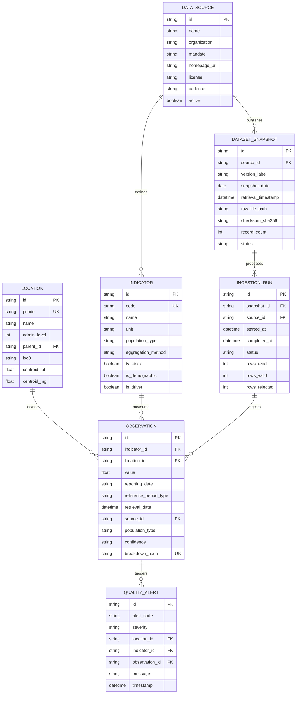

# Data Dictionary & Schema Model

**Project:** Ethiopia Migration & Displacement Observatory  
**Version:** 1.0  
**Date:** October 2026  
**Status:** Approved Data Architecture  

---

## 1. Overview & Core Principles

The data architecture of the Ethiopia Migration & Displacement Observatory is designed around five foundational rules:

1. **Strict Separation of Time Domains:**  
   - `reporting_date` (Observation Reference Date): The historical calendar moment or period that the data actually measures (e.g., Round 37 site assessment August 2024).  
   - `retrieval_timestamp` (Pipeline Ingestion Date): The UTC timestamp when the observatory script retrieved and parsed the data from the upstream publisher.
2. **Mandate-Preserved Population Taxonomy:**  
   Population types (`idp`, `refugee`, `asylum_seeker`, `returnee`, `international_migrant`) remain strictly partitioned and are never summed into an ambiguous composite total.
3. **Idempotent Versioned Snapshots:**  
   Every raw download is checksummed (SHA-256) and preserved in `/data/raw/<source>/<snapshot_id>`. Downstream failures or upstream API changes can never overwrite or erase valid historic snapshots.
4. **Transparent Quality Tracking:**  
   Validation warnings, missing demographic breakdowns, and temporal anomalies generate auditable `quality_alerts` linked directly to observations and locations.
5. **No Invented Numbers:**  
   Zero is explicitly distinguished from `null` (unassessed/unavailable) and suppressed counts.

---

## 2. Entity Relationship Diagram (ERD)



---

## 3. Detailed Data Dictionary

### Table 1: `data_sources`
Tracks official publishing agencies, legal licenses, and update expectations.

| Column | Type | Constraints | Description |
| :--- | :--- | :--- | :--- |
| `id` | `VARCHAR(32)` | `PRIMARY KEY` | Unique slug (e.g. `iom_dtm`, `unhcr`, `un_desa`, `idmc`). |
| `name` | `VARCHAR(128)` | `NOT NULL` | Full publisher name (e.g. "IOM Displacement Tracking Matrix Ethiopia"). |
| `organization` | `VARCHAR(128)` | `NOT NULL` | Parent organization (e.g. "International Organization for Migration"). |
| `mandate` | `TEXT` | `NOT NULL` | Legal or humanitarian scope (e.g. "Internal Displacement & Returnees"). |
| `homepage_url` | `VARCHAR(512)` | `NOT NULL` | Official public portal URL. |
| `api_url` | `VARCHAR(512)` | `NULLABLE` | Documented public REST/CKAN API endpoint if available. |
| `license` | `VARCHAR(64)` | `NOT NULL` | Copyright or open access license (e.g. `CC BY 4.0`). |
| `attribution_text`| `TEXT` | `NOT NULL` | Mandatory citation string required by terms of use. |
| `cadence` | `VARCHAR(32)` | `NOT NULL` | Publication cycle: `weekly`, `bimonthly`, `monthly`, `annual`, `5_year`. |
| `active` | `BOOLEAN` | `DEFAULT TRUE` | Whether the source is currently polled by ingestion pipelines. |

---

### Table 2: `dataset_snapshots`
Records immutable, versioned raw payloads downloaded from source publishers.

| Column | Type | Constraints | Description |
| :--- | :--- | :--- | :--- |
| `id` | `VARCHAR(64)` | `PRIMARY KEY` | Formatted: `snap_<source>_<version>_<YYYYMMDD>`. |
| `source_id` | `VARCHAR(32)` | `FK -> data_sources(id)` | Publishing agency reference. |
| `version_label` | `VARCHAR(64)` | `NOT NULL` | Version identifier (e.g. "Round 37", "2024-Q2", "Revision 2024"). |
| `snapshot_date` | `DATE` | `NOT NULL` | Publisher release date or reference date. |
| `retrieval_timestamp`| `TIMESTAMP WITH TIME ZONE` | `NOT NULL` | Exact UTC time downloaded by the observatory ingestion pipeline. |
| `raw_file_path` | `VARCHAR(512)` | `NOT NULL` | Relative path to local stored payload (`/data/raw/...`). |
| `raw_format` | `VARCHAR(16)` | `NOT NULL` | Payload format: `json`, `csv`, `xlsx`, `xml`. |
| `checksum_sha256` | `CHAR(64)` | `NOT NULL` | SHA-256 cryptographic hash guaranteeing payload immutability. |
| `byte_size` | `BIGINT` | `NOT NULL` | Raw file size in bytes. |
| `record_count` | `INTEGER` | `NOT NULL` | Number of raw rows/items in payload. |
| `status` | `VARCHAR(32)` | `NOT NULL` | `pending`, `validated`, `partially_valid`, `failed`, `superseded`. |

---

### Table 3: `locations`
Standardized Ethiopian administrative units and international country entities.

| Column | Type | Constraints | Description |
| :--- | :--- | :--- | :--- |
| `id` | `VARCHAR(32)` | `PRIMARY KEY` | Normalized code (e.g. `ET`, `ET01`, `ET0401`). |
| `pcode` | `VARCHAR(32)` | `UNIQUE, NOT NULL`| Authoritative UN OCHA Common Operational Dataset P-Code. |
| `name` | `VARCHAR(128)` | `NOT NULL` | English standardized gazetteer name. |
| `name_amharic` | `VARCHAR(128)` | `NULLABLE` | Amharic script name (e.g. "ትግራይ", "ኦሮሚያ"). |
| `admin_level` | `SMALLINT` | `NOT NULL (0..3)` | `0` = National, `1` = Region, `2` = Zone, `3` = Woreda. |
| `parent_id` | `VARCHAR(32)` | `FK -> locations(id)` | Parent administrative unit code (self-referential hierarchy). |
| `iso3` | `CHAR(3)` | `DEFAULT 'ETH'` | ISO 3166-1 alpha-3 code. |
| `centroid_lat` | `FLOAT` | `NULLABLE` | Geographic center latitude (-90.0 to 90.0). |
| `centroid_lng` | `FLOAT` | `NULLABLE` | Geographic center longitude (-180.0 to 180.0). |
| `bbox` | `JSON` | `NULLABLE` | `[minLng, minLat, maxLng, maxLat]` bounding envelope. |
| `status` | `VARCHAR(16)` | `DEFAULT 'active'`| `active`, `historical`, `disputed`. |

---

### Table 4: `indicators`
Definitions of measurable migration and displacement variables.

| Column | Type | Constraints | Description |
| :--- | :--- | :--- | :--- |
| `id` | `VARCHAR(64)` | `PRIMARY KEY` | Standard indicator slug (e.g. `idp_stock_present`). |
| `code` | `VARCHAR(32)` | `UNIQUE, NOT NULL`| Alphanumeric code (e.g. `IND_IDP_01`). |
| `name` | `VARCHAR(128)` | `NOT NULL` | Human-readable title for charts and cards. |
| `description` | `TEXT` | `NOT NULL` | Detailed methodological definition. |
| `unit` | `VARCHAR(32)` | `NOT NULL` | `individuals`, `households`, `events`, `percentage`, `rate_per_1000`. |
| `population_type` | `VARCHAR(32)` | `NOT NULL` | `idp`, `refugee`, `asylum_seeker`, `returnee`, `international_migrant`. |
| `aggregation_method`| `VARCHAR(32)`| `NOT NULL` | `sum`, `average`, `weighted_mean`, `latest_only`, `max`. |
| `is_stock` | `BOOLEAN` | `NOT NULL` | `TRUE` if static snapshot; `FALSE` if flow during period. |
| `is_demographic` | `BOOLEAN` | `DEFAULT FALSE` | `TRUE` if disaggregated by sex/age group. |
| `is_driver` | `BOOLEAN` | `DEFAULT FALSE` | `TRUE` if measuring displacement cause/trigger. |
| `default_source_id`| `VARCHAR(32)` | `FK -> data_sources(id)` | Primary reporting originator. |

---

### Table 5: `observations`
The core atomic fact table storing verified statistical records.

| Column | Type | Constraints | Description |
| :--- | :--- | :--- | :--- |
| `id` | `VARCHAR(64)` | `PRIMARY KEY` | Unique observation identifier. |
| `indicator_id` | `VARCHAR(64)` | `FK -> indicators(id)` | Indicator definition reference. |
| `location_id` | `VARCHAR(32)` | `FK -> locations(id)` | Geographic administrative boundary reference. |
| `value` | `FLOAT` | `NOT NULL (>= 0)` | Numeric observation figure. |
| `reporting_date` | `VARCHAR(10)` | `NOT NULL` | Observation reference time: `YYYY`, `YYYY-MM`, or `YYYY-MM-DD`. |
| `reference_period_type`| `VARCHAR(16)`| `NOT NULL` | `day`, `month`, `quarter`, `year`, `round`. |
| `retrieval_date` | `TIMESTAMP WITH TIME ZONE` | `NOT NULL` | Pipeline execution timestamp when record was ingested. |
| `source_id` | `VARCHAR(32)` | `FK -> data_sources(id)` | Primary data originator reference. |
| `population_type` | `VARCHAR(32)` | `NOT NULL` | Mandate population partition. |
| `confidence` | `VARCHAR(16)` | `DEFAULT 'medium'` | `high`, `medium`, `low`, `unverified`. |
| `sex` | `VARCHAR(16)` | `NULLABLE` | `female`, `male`, `unspecified`. |
| `age_group` | `VARCHAR(32)` | `NULLABLE` | Age bracket (e.g. `0-4`, `5-11`, `12-17`, `18-59`, `60+`). |
| `driver` | `VARCHAR(32)` | `NULLABLE` | Displacement trigger: `conflict`, `drought`, `floods`, `seasonal_pastoral`. |
| `origin_location_id`| `VARCHAR(32)` | `NULLABLE` | Origin P-code for bilateral displacement/migration flow. |
| `destination_location_id`| `VARCHAR(32)`| `NULLABLE` | Destination P-code for bilateral flow. |
| `breakdown_hash` | `CHAR(32)` | `NOT NULL` | MD5 hash of `(sex, age_group, driver, origin, destination)` for composite uniqueness. |
| `quality_notes` | `TEXT` | `NULLABLE` | Contextual caveats, sampling notes, or coverage gaps. |

---

### Table 6: `quality_alerts`
Auditable data quality warnings generated during validation or comparative analysis.

| Column | Type | Constraints | Description |
| :--- | :--- | :--- | :--- |
| `id` | `VARCHAR(64)` | `PRIMARY KEY` | Unique alert ID. |
| `alert_code` | `VARCHAR(32)` | `NOT NULL` | Alert classification code (see taxonomy below). |
| `severity` | `VARCHAR(16)` | `NOT NULL` | `info`, `warning`, `critical`. |
| `location_id` | `VARCHAR(32)` | `NULLABLE FK` | Administrative unit affected. |
| `indicator_id` | `VARCHAR(64)` | `NULLABLE FK` | Indicator definition affected. |
| `observation_id` | `VARCHAR(64)` | `NULLABLE FK` | Specific observation record if applicable. |
| `message` | `TEXT` | `NOT NULL` | Clear explanation of the anomaly or caveat. |
| `timestamp` | `TIMESTAMP WITH TIME ZONE` | `NOT NULL` | Time when alert was triggered. |

---

## 4. Indexing & Composite Uniqueness Strategy

To ensure queries remain fast and duplicate observations are rejected:

1. **Composite Uniqueness Key on Observations:**
   ```sql
   UNIQUE (location_id, indicator_id, reporting_date, population_type, breakdown_hash)
   ```
   *Prevents double-counting identical records from overlapping ingestion runs.*

2. **Temporal & Geographic Query Indexes:**
   ```sql
   CREATE INDEX idx_obs_location_indicator ON observations (location_id, indicator_id, reporting_date);
   CREATE INDEX idx_obs_pop_type ON observations (population_type, reporting_date);
   CREATE INDEX idx_obs_reporting_date ON observations (reporting_date);
   CREATE INDEX idx_location_parent ON locations (parent_id, admin_level);
   CREATE INDEX idx_snapshots_source ON dataset_snapshots (source_id, snapshot_date);
   ```

---

## 5. Quality Check Taxonomy & Rules

| Alert Code | Severity | Trigger Condition | Recommended User Action |
| :--- | :--- | :--- | :--- |
| `MISSING_BREAKDOWN` | `info` | Total count present, but age/sex breakdown unassessed. | Display total with notice indicating breakdown is unavailable. |
| `CONFUSION_RISK` | `warning` | User attempts to sum IDPs and refugees into a single metric. | Intercept calculation; display distinct cards with mandate explanation. |
| `TEMPORAL_GAP` | `warning` | Expected monthly/bimonthly round missing for >90 days. | Display dotted trend interpolation with gap notice. |
| `IMPLAUSIBLE_SPIKE` | `warning` | Caseload changes >150% in a single reporting interval. | Highlight data point with source verification note. |
| `STALE_SNAPSHOT` | `warning` | Source has exceeded scheduled publication cadence. | Show amber status dot indicating publisher delay. |
| `GEOGRAPHIC_MISMATCH`| `critical`| Assessment site coordinates fall outside referenced Admin 2 zone. | Quarantine record; alert ingestion administrator. |
